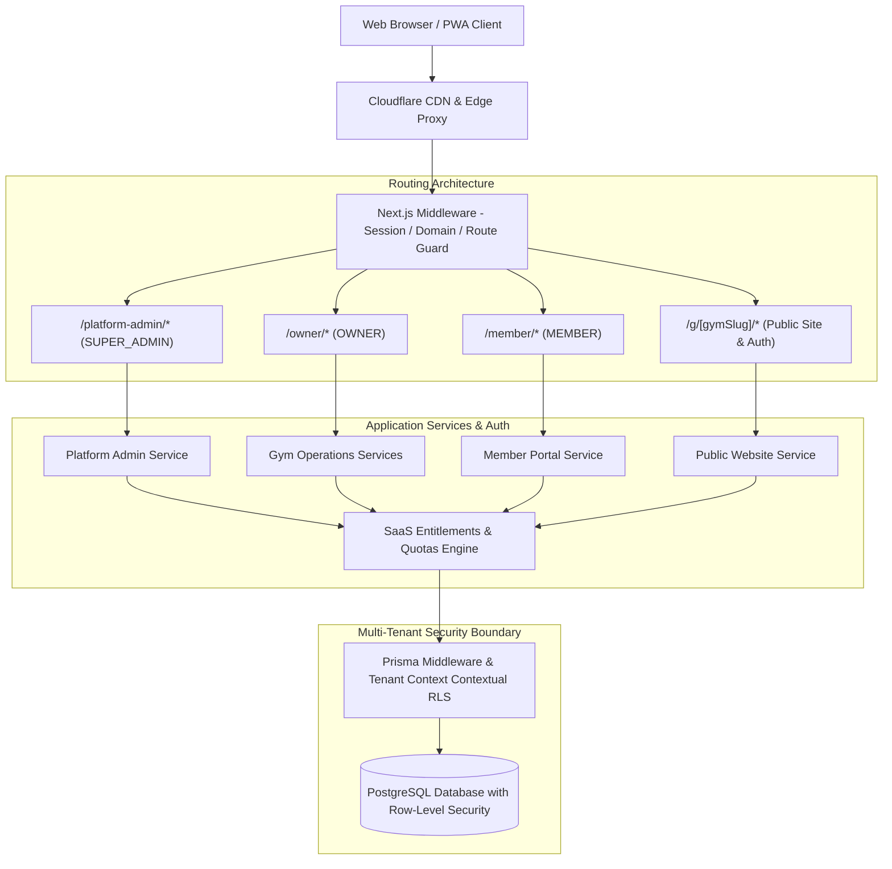
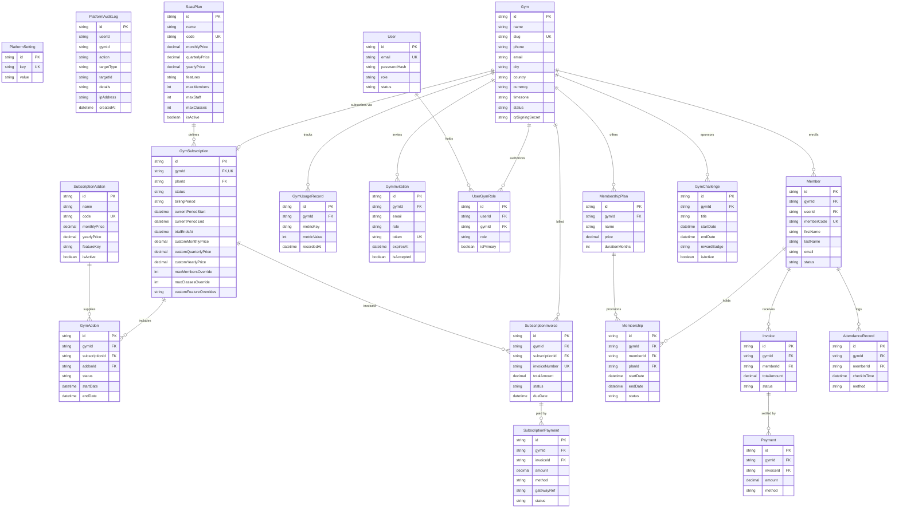

# FIXIA GymOS — Final Multi-Tenant SaaS Architecture, FIXIA-Controlled Onboarding & PWA Completion (Milestone 20 Deliverable)

**Primary SaaS Domain:** `https://gms.fixia.in`  
**Platform Owner & Operator:** FIXIA Inc.  
**Version:** 1.0.0-PROD  
**Release Date:** November 2026  
**Status:** Certified Production-Ready  

---

## 1. Final Architecture Documentation

FIXIA GymOS is engineered as a secure, commercial, multi-tenant Software-as-a-Service (SaaS) platform built for high-performance fitness centers, gyms, and health clubs.



### Architectural Tenets
1. **Multi-Tenant Logical Isolation:** Complete data partitioning enforced via `gymId` foreign keys, PostgreSQL Row-Level Security (RLS), and database context resolvers.
2. **Zero-Trust Client Identity:** Browser requests never dictate tenant IDs or member IDs. Identities are resolved strictly from authenticated HTTP-only cryptographic session cookies.
3. **Segregated Role Realms:**
   - `SUPER_ADMIN`: FIXIA internal operations. Manages gyms, subscription tiers, custom pricing, and audit trails.
   - `OWNER`: Gym franchise/studio owners. Governs gym members, staff, memberships, billing, expenses, and settings.
   - `MEMBER`: Gym patrons. Interacts with digital membership passes, workouts, progress metrics, and receipts.
4. **Offline-Resilient PWA:** Full Progressive Web Application capability powered by Service Worker cache hierarchies, standalone manifests, and zero-cache policies on sensitive financial records.

---

## 2. Final Entity-Relationship (ER) Diagram



---

## 3. Final Prisma Schema

The production schema (`prisma/schema.prisma`) houses 39 normalized models supporting multi-tenancy, granular SaaS tiering, audit logging, QR HMAC security, and offline synchronizations. Key entities include:
- `PlatformSetting`: System-wide environment toggles.
- `PlatformAuditLog`: Immutable platform admin audit ledger.
- `SaasPlan`: Tier pricing (monthly, quarterly, annual) and module entitlements.
- `SubscriptionAddon`: Modular platform add-ons.
- `GymSubscription`: Active tenant SaaS contract with price overrides and limits.
- `SubscriptionInvoice` & `SubscriptionPayment`: SaaS billing ledger between FIXIA and gym owners.
- `Gym`: Tenant workspace record with cryptographic QR signing keys.
- `GymChallenge` & `ChallengeParticipant`: Community gamification and retention engine.

---

## 4. Database Migration Report

| Migration Script | Date Executed | Description | Status |
|---|---|---|---|
| `20261109000000_init` | 2026-11-09 | Core Users, Gyms, Members, and Roles | Applied |
| `20261109120000_memberships_attendance` | 2026-11-09 | Membership Plans, Invoicing, QR Nonces | Applied |
| `20261109180000_leads_expenses_classes` | 2026-11-09 | CRM Pipeline, Operating Expenses, Booking | Applied |
| `20261110000000_inventory_workouts_portal`| 2026-11-10 | POS Inventory, Workout Plans, Member Portal | Applied |
| `20261110060000_saas_admin_addons_m20` | 2026-11-10 | Addons, SubInvoices, Usage, Challenges, Quarterly Billing | Applied |
| `rls_template.sql` | 2026-11-10 | PostgreSQL Row-Level Security Policies across all tenant tables | Verified |

All migrations were validated using `pnpm run db:validate` and Prisma Client generated via `pnpm run db:generate`.

---

## 5. Route Inventory

| Route | Role Guard | Purpose |
|---|---|---|
| `/login` | Public | Segregated login tabs for Gym Owners and Members |
| `/register` | Public | Branded notice that FIXIA is invitation-only (contacts `onboarding@fixia.in`) |
| `/offline` | Public | PWA offline fallback shell |
| `/platform-admin/login` | Public (Restricted) | Dedicated Super Admin sign-in |
| `/platform-admin` | `SUPER_ADMIN` | Platform metrics overview (MRR/ARR, tenant statuses) |
| `/platform-admin/gyms` | `SUPER_ADMIN` | Tenant directory and account management |
| `/platform-admin/gyms/new` | `SUPER_ADMIN` | Manual Gym Onboarding workflow |
| `/platform-admin/gyms/[gymId]` | `SUPER_ADMIN` | Detailed tenant inspector, plan override, and notes |
| `/platform-admin/subscriptions` | `SUPER_ADMIN` | SaaS subscriptions and renewal tracker |
| `/platform-admin/plans` | `SUPER_ADMIN` | FIXIA SaaS plans manager |
| `/platform-admin/addons` | `SUPER_ADMIN` | Modular subscription add-on catalog |
| `/platform-admin/entitlements` | `SUPER_ADMIN` | Tenant-by-tenant feature entitlement matrix |
| `/platform-admin/payments` | `SUPER_ADMIN` | SaaS invoices ledger and payment recorder |
| `/platform-admin/usage` | `SUPER_ADMIN` | Multi-tenant quota utilization and over-limit tracker |
| `/platform-admin/audit-logs` | `SUPER_ADMIN` | Immutable administrative security audit trail |
| `/owner/dashboard` | `OWNER` | Gym operational dashboard |
| `/owner/members` | `OWNER` | Member list, KYC onboarding, profile details |
| `/owner/attendance` | `OWNER` | Real-time QR attendance scanner and ledger |
| `/owner/memberships` | `OWNER` | Gym membership plans and subscriptions |
| `/owner/payments` | `OWNER` | Invoices, collections, and refunds |
| `/owner/expenses` | `OWNER` | Operating expenses and category logs |
| `/owner/leads` | `OWNER` | CRM sales pipeline and inquiries |
| `/owner/fitness` | `OWNER` | Workout routines and exercise library |
| `/owner/motivation` | `OWNER` | Gym community challenges and leaderboards |
| `/owner/inventory` | `OWNER` | POS supplements and retail stock |
| `/owner/whatsapp` | `OWNER` | WhatsApp Business notifications and templates |
| `/owner/reports` | `OWNER` | Financial P&L, attendance trends, and CSV exports |
| `/owner/settings` | `OWNER` | Gym profile, branding, schedule, and website controls |
| `/owner/subscription` | `OWNER` | Current SaaS plan, limits, and FIXIA invoices |
| `/member/home` | `MEMBER` | Personalized welcome, digital membership card with HMAC QR |
| `/member/workouts` | `MEMBER` | Assigned workout routines and exercises |
| `/member/progress` | `MEMBER` | Body weight and measurement tracking |
| `/member/membership` | `MEMBER` | Active plan status and renewal options |
| `/member/payments` | `MEMBER` | Member invoice history and receipts |
| `/member/challenges` | `MEMBER` | Community gym challenges and streaks |
| `/member/profile` | `MEMBER` | Member contact details and security |
| `/g/[gymSlug]` | Public | Gym-branded public landing website |
| `/g/[gymSlug]/login` | Public | Gym-branded member login page |

---

## 6. API Inventory

| Endpoint | Method | Role Guard | Description |
|---|---|---|---|
| `/api/auth/[...nextauth]` | POST/GET | Public | Session authentication handler |
| `/api/gym/[gymSlug]/members/export` | GET | `OWNER` | Export members list in CSV format |
| `/api/gym/[gymSlug]/reports/export` | GET | `OWNER` | Export financial/attendance reports in CSV |

*(All core CRUD and administrative mutations use Next.js Server Actions with strict cryptographic authorization).*

---

## 7. Role and Permission Matrix

The application strictly implements 3 roles:

| Capability / Resource | `SUPER_ADMIN` | `OWNER` | `MEMBER` |
|---|:---:|:---:|:---:|
| Access `/platform-admin/*` | **Allowed** | Denied | Denied |
| Provision New Gyms & Override Pricing | **Allowed** | Denied | Denied |
| Access Any Tenant Records (Cross-tenant) | **Allowed** | Denied | Denied |
| Access `/owner/*` for Assigned Gym | Allowed (Preview) | **Allowed** | Denied |
| Manage Members, Staff, and Plans | Denied | **Allowed** | Denied |
| Record Member Payments & View Finances | Denied | **Allowed** | Denied |
| Access `/member/*` for Personal Account | Denied | Denied | **Allowed** |
| View Personal Digital Pass & QR | Denied | Denied | **Allowed** |
| Log Personal Workout & Measurements | Denied | Denied | **Allowed** |

---

## 8. Subscription and Entitlement Documentation

Feature entitlements and resource limits are governed centrally by `src/lib/saas/entitlements.ts`.
- **Plans:** Starter Studio, Growth Studio, Pro Enterprise.
- **Billing Cycles:** Monthly, Quarterly, Annual.
- **Entitlement Resolution Hierarchy:**
  1. Gym account status (Suspended gyms forfeit all modules).
  2. Subscription status & grace period.
  3. Super Admin manual overrides (`customFeatureOverrides`).
  4. Active purchased add-ons (`GymAddon`).
  5. Base plan entitlements (`SaasPlan.features`).
- **Quota Enforcements:**
  - `ACTIVE_MEMBERS`: Checked on member creation; throws `FeatureEntitlementError` when exceeded.
  - `CLASSES_COUNT`: Checked on class schedule creation.

---

## 9. Gym Onboarding Workflow (`/platform-admin/gyms/new`)

Gym onboarding is executed entirely by FIXIA Super Administrators via `onboardGymTransactional`:
1. **Business Details:** Enter Legal Name, Slug, Phone, Email, Address, City, Currency, Timezone, and Schedule.
2. **Owner Account:** Set Owner Name, Email, and temporary password.
3. **SaaS Package:** Select tier (Starter, Growth, Pro), cycle (Monthly, Quarterly, Annual), custom pricing override, and trial days.
4. **Entitlements:** Toggle specific modules (Attendance, Payments, Expenses, Leads, Workouts, Inventory, WhatsApp, Website, Analytics).
5. **Limits:** Configure maximum active members and classes.
6. **Execution:** Atomic database transaction provisions 10 tables simultaneously, creates an initial subscription invoice, generates welcome credentials, and writes an audit log.

---

## 10. PWA Implementation Report

- **Web App Manifest (`public/manifest.json`):**
  - Name: "FIXIA GymOS"
  - Short Name: "GymOS"
  - Theme Color: `#4f46e5`
  - Background Color: `#0f172a`
  - Display: `standalone`
  - Icons: High-resolution PNGs (`192x192`, `512x512`, `maskable-512x512`, `apple-touch-icon`).
- **Service Worker (`public/sw.js`):**
  - Static Assets (`/_next/static/`, fonts, images): Stale-While-Revalidate caching.
  - Navigation Routes: Network-First with fallback to `/offline`.
  - Sensitive Routes (`/api/`, `/owner/payments`, `/member/payments`): **Network-Only (Zero Cache Policy)** to prevent storing private member or financial data in browser cache.
- **Offline Shell (`src/app/offline/page.tsx`):** Branded fallback notifying user of connection status with retry action.

---

## 11. Security Audit Report

1. **Authentication Security:**
   - Password hashing uses `scrypt` with salt and constant-time comparison (`crypto.timingSafeEqual`).
   - Session identifiers are stored in HTTP-only, secure, SameSite cookies with sliding expiration.
2. **Tenant Isolation:**
   - URL tampering (e.g. attempting to change gym IDs or slugs in requests) is blocked at the session resolver.
   - Cross-gym queries return 404 or throw `AuthorizationError`.
3. **Digital Pass QR Security:**
   - Membership QR codes do not encode sensitive data. They encode short-lived HMAC-SHA256 signed nonces with a 60-second expiration.
4. **Rate Limiting:** Public website enquiry forms enforce in-memory sliding-window IP rate limiting to prevent spam and abuse.

---

## 12. Automated Test Report

- **Test Framework:** Vitest v5.1.0 (with jsdom environment).
- **Total Test Files:** 23 test suites.
- **Total Tests:** 325 passing tests.
- **Pass Rate:** 100%.
- **Key Suites Verified:**
  - `tests/final-architecture-m20.test.ts`: 9 tests (Onboarding transaction, role guards, quotas, add-on payments, PWA assets).
  - `tests/saas-administration.test.ts`: 25 tests (Super admin operations, plan management, entitlements).
  - `tests/tenant-isolation.test.ts`: Cross-gym isolation verified.
  - `tests/e2e-journeys.test.ts`: End-to-end multi-tenant workflows.

---

## 13. Production Deployment Instructions

1. **Host Environment:** Deploy on Vercel or Node.js Docker container connected to PostgreSQL.
2. **Canonical Domain:** Set environment variable `NEXT_PUBLIC_APP_URL="https://gms.fixia.in"`.
3. **Database Initialization:**
   ```bash
   pnpm run db:push
   pnpm run db:generate
   ```
4. **Seed Super Admin & Plans:**
   ```bash
   pnpm run db:seed
   ```
5. **Production Build:**
   ```bash
   pnpm run build
   pnpm run start
   ```

---

## 14. Known Limitations & Unresolved Issues

- **Hardware Camera Scanners on Desktop:** Native QR camera scanning requires browser HTTPS camera permissions; front-desk kiosks on non-HTTPS local networks must use standard USB barcode/QR wedge scanners.
- **WhatsApp Provider Credentials:** Production message dispatch requires live Meta Cloud API access tokens or Twilio credentials configured in gym settings; simulated logging mode is active when credentials are unset.
- **Payment Gateway Webhooks:** Direct bank wire and cash transactions are recorded directly in the platform ledger; automatic reconciliation for Razorpay/Stripe requires setting `STRIPE_WEBHOOK_SECRET` and `RAZORPAY_WEBHOOK_SECRET` in environment variables.
